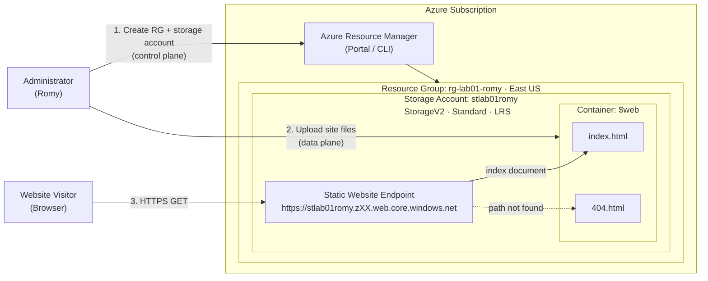
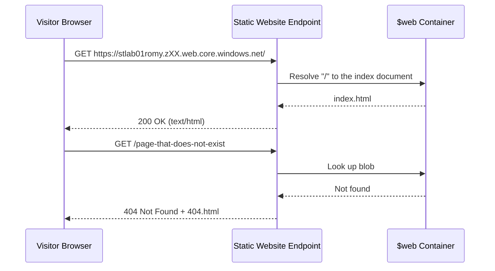
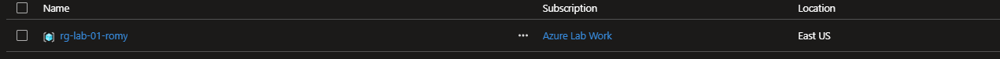
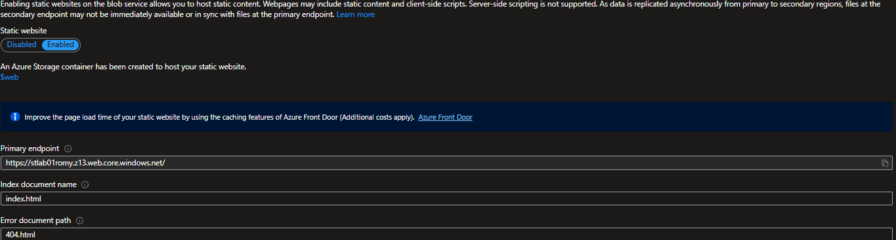
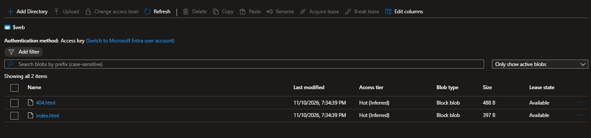
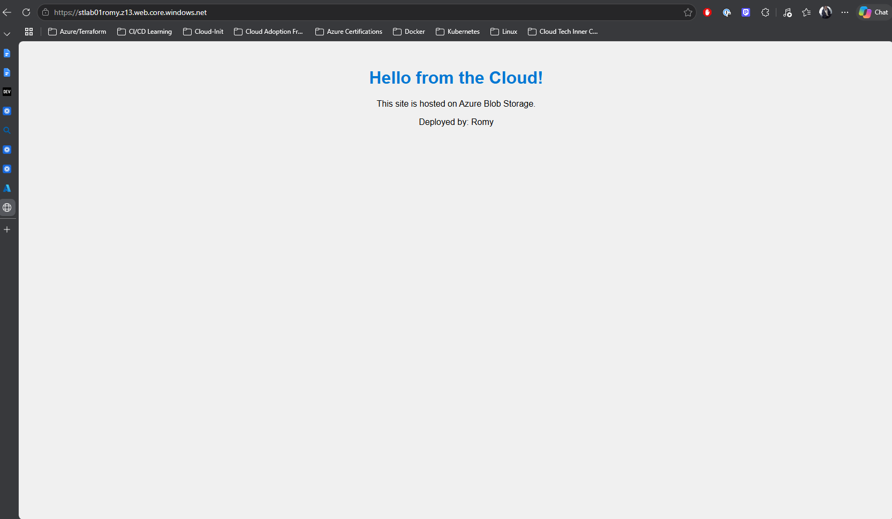
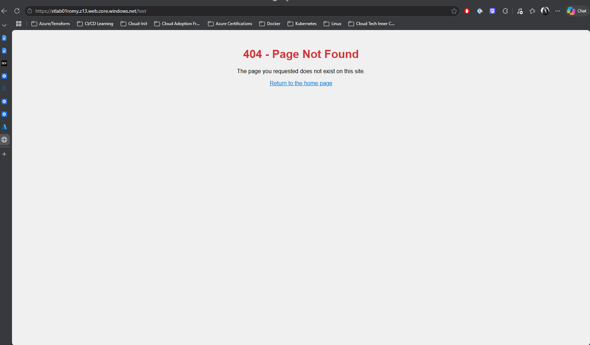

# Azure Blob Storage Static Website Hosting


> Deploying a public website on Azure **without provisioning a single server**, using the static website feature of Azure Blob Storage (PaaS).

**Author:** Romy Francis ([@R-Cipher](https://github.com/R-Cipher) · [LinkedIn](https://www.linkedin.com/in/romy-francis))

---

## Watch me walkthrough this lab!
> https://www.loom.com/share/d01e594356264a2ca5f0b21a43e71313
---

## At a Glance

| | |
|---|---|
| **What I built** | A publicly reachable website served directly from an Azure Storage account, with a custom index page and custom 404 page |
| **Azure services** | Resource Groups, Storage Accounts (StorageV2), Blob Storage static website hosting |
| **Skills demonstrated** | Resource organization and naming conventions, PaaS hosting, storage account configuration, control plane vs. data plane operations, validation with `curl`, Azure CLI equivalents, cost-aware cleanup |
| **Region** | East US |
| **Cost** | Negligible for lab traffic (a few KB of storage on LRS); all resources deleted at the end |

---

## Table of Contents

1. [Objective](#1-objective)
2. [Architecture](#2-architecture)
3. [Design Decisions](#3-design-decisions)
4. [Prerequisites](#4-prerequisites)
5. [Naming Convention](#5-naming-convention)
6. [Repository Structure](#6-repository-structure)
7. [Deployment Steps (Azure Portal)](#7-deployment-steps-azure-portal)
8. [Validation](#8-validation)
9. [Azure CLI Equivalent](#9-azure-cli-equivalent)
10. [Troubleshooting](#10-troubleshooting)
11. [Clean Up](#11-clean-up)
12. [Security and Cost Notes](#12-security-and-cost-notes)
13. [Key Takeaways and Next Steps](#13-key-takeaways-and-next-steps)

---

## 1. Objective

Deploy a public-facing website in Azure using **Azure Blob Storage static website hosting** instead of a virtual machine or web server.

This lab demonstrates the shift from IaaS to PaaS thinking: rather than building, patching, and securing a server to serve a few HTML files, the content is placed in a storage container and Azure handles the web serving, availability, and TLS on the default endpoint.

**By the end of this lab:**

- A resource group and storage account exist in East US, named to a consistent convention
- Static website hosting is enabled with an index document and an error document
- `index.html` and `404.html` are served from the `$web` container over HTTPS
- The deployment is validated from a browser and from the command line
- All resources are removed to avoid ongoing cost

---

## 2. Architecture

### Component Diagram



### Request Flow



### Components

| Component | Name | Purpose |
|---|---|---|
| Resource Group | `rg-lab01-romy` | Logical container for all lab resources; deleting it removes everything in one action |
| Storage Account | `stlab01romy` | General-purpose v2 account that hosts the site content and exposes the web endpoint |
| `$web` container | Created automatically | The only container served by the static website endpoint |
| Index document | `index.html` | Returned when a visitor requests the site root |
| Error document | `404.html` | Returned when a requested path does not exist |
| Web endpoint | `https://stlab01romy.zXX.web.core.windows.net` | Public HTTPS URL for the site (the `zXX` zone value is assigned by Azure and varies by region) |

---

## 3. Design Decisions

| Decision | Choice | Reasoning | Production alternative |
|---|---|---|---|
| Hosting model | Blob Storage static website | No servers to manage, patch, or scale; pay only for storage and transactions. Well-suited to HTML/CSS/JS with no server-side code. | **Azure Static Web Apps** for built-in GitHub Actions CI/CD and free managed certificates on custom domains; **App Service** if server-side code is needed |
| Compute | None (PaaS) | A VM would add OS patching, NSG configuration, and a web server for content that needs none of it | — |
| Redundancy | Locally-redundant storage (LRS) | Lowest cost; the site content is fully reproducible from this repository, so losing a copy is low impact | **ZRS** for zone resilience, or **RA-GRS** for a readable secondary web endpoint in the paired region |
| Region | East US | Standard lab region with full service availability | Region closest to users, fronted by **Azure Front Door** for global caching |
| Deployment method | Azure Portal (with CLI equivalent documented) | Builds familiarity with the resource settings before automating them | Bicep or Terraform, deployed through a CI/CD pipeline |
| Naming | `rg-` / `st` prefixes | Follows Microsoft Cloud Adoption Framework abbreviations so resource types are identifiable at a glance | Same convention, extended with environment and instance (e.g. `rg-web-prod-eus-001`) |

---

## 4. Prerequisites

- [ ] An active Azure subscription (Free Tier is sufficient)
- [ ] Permission to create resource groups and storage accounts (Contributor or Owner on the subscription)
- [ ] A text editor (VS Code, Notepad, or TextEdit)
- [ ] *(Optional, for Section 9)* [Azure CLI](https://learn.microsoft.com/cli/azure/install-azure-cli) installed, or access to [Azure Cloud Shell](https://shell.azure.com)

---

## 5. Naming Convention

| Variable | Value | Notes |
|---|---|---|
| Resource Group | `rg-lab01-romy` | Holds our storage account |
| Location | East US (`eastus`) | Location of our resource/group |
| Storage Account | `stlab01romy` | Must be **globally unique**, 3–24 characters, **lowercase letters and numbers only** |

> **Replicating this lab?** Replace `romy` with your own name. If the storage account name is taken, append digits (e.g. `stlab01romy42`).

---

## 6. Repository Structure

```
azure-blob-static-website/
├── README.md          # This document
├── src/
│   ├── index.html     # Site home page (index document)
│   └── 404.html       # Custom error page (error document)
└── docs/
    └── images/        # Deployment screenshots
```

---

## 7. Deployment Steps (Azure Portal)

### Phase 1: Create the Resource Group

1. Sign in to the [Azure Portal](https://portal.azure.com).
2. Search for **Resource groups** in the top search bar and select it.
3. Select **+ Create**.
4. On the **Basics** tab:
   - **Subscription:** your subscription
   - **Resource group:** `rg-lab01-romy`
   - **Region:** (US) East US
5. Select **Review + create**, then **Create**.

### Phase 2: Create the Storage Account

1. Search for **Storage accounts** and select **+ Create**.
2. On the **Basics** tab:
   - **Resource group:** `rg-lab01-romy`
   - **Storage account name:** `stlab01romy`
   - **Region:** (US) East US
   - **Primary service** *(if shown)*: Azure Blob Storage or Azure Data Lake Storage Gen 2
   - **Performance:** Standard
   - **Redundancy:** Locally-redundant storage (LRS)
3. Leave all other tabs at their defaults.
4. Select **Review + create**, wait for validation to pass, then select **Create**.
5. When deployment completes (about 30 seconds), select **Go to resource**.

### Phase 3: Enable Static Website Hosting

1. In the storage account's left menu, under **Data management**, select **Static website**.
2. Set **Static website** to **Enabled**.
3. **Index document name:** `index.html`
4. **Error document path:** `404.html`
5. Select **Save**.
6. Copy the **Primary endpoint** URL that appears (format: `https://stlab01romy.zXX.web.core.windows.net/`). This is the website's public address.

> Enabling static website hosting automatically creates the `$web` container.

### Phase 4: Create the Website Files

Create a folder named `src` and save the following two files in it.

**`src/index.html`**

```html
<!DOCTYPE html>
<html lang="en">
<head>
    <meta charset="UTF-8">
    <title>My First Cloud Site</title>
    <style>
        body { font-family: sans-serif; text-align: center; margin-top: 50px; background-color: #f0f0f0; }
        h1 { color: #0078d4; }
    </style>
</head>
<body>
    <h1>Hello from the Cloud!</h1>
    <p>This site is hosted on Azure Blob Storage.</p>
    <p>Deployed by: Romy</p>
</body>
</html>
```

**`src/404.html`**

```html
<!DOCTYPE html>
<html lang="en">
<head>
    <meta charset="UTF-8">
    <title>Page Not Found</title>
    <style>
        body { font-family: sans-serif; text-align: center; margin-top: 50px; background-color: #f0f0f0; }
        h1 { color: #d13438; }
        a { color: #0078d4; }
    </style>
</head>
<body>
    <h1>404 - Page Not Found</h1>
    <p>The page you requested does not exist on this site.</p>
    <p><a href="/">Return to the home page</a></p>
</body>
</html>
```

> File names are case-sensitive. They must be exactly `index.html` and `404.html`.

### Phase 5: Upload the Content

1. In the storage account's left menu, under **Data storage**, select **Containers**.
2. Open the **`$web`** container.
3. Select **Upload**, browse to your `src` folder, and select both `index.html` and `404.html`.
4. Select **Upload**.

---

## 8. Validation

### Browser test

1. Open a new browser tab and paste the **Primary endpoint** URL.
2. Expected result: the **"Hello from the Cloud!"** page.
3. Append a path that doesn't exist (e.g. `/test`). Expected result: the custom **404 - Page Not Found** page.

### Command-line test

```bash
# Expect: HTTP/1.1 200 OK and Content-Type: text/html
curl -I https://stlab01romy.zXX.web.core.windows.net/

# Expect: HTTP/1.1 404 The requested content does not exist.
curl -I https://stlab01romy.zXX.web.core.windows.net/test
```

### Evidence

| Step | Screenshot |
|---|---|
| Resource group created |  |
| Static website enabled with primary endpoint |  |
| Files uploaded to `$web` |  |
| Site live in browser |  |
| Custom 404 page |  |

---

## 9. Azure CLI Equivalent

The same deployment as Section 7, scripted. Runs in Bash or [Azure Cloud Shell](https://shell.azure.com) from the repository root.

```bash
# Variables
RG="rg-lab01-romy"
LOCATION="eastus"
SA="stlab01romy"   # must be globally unique

# Sign in (skip in Cloud Shell)
az login

# Confirm the storage account name is available
az storage account check-name --name "$SA" --query "nameAvailable"

# Phase 1: Resource group
az group create --name "$RG" --location "$LOCATION"

# Phase 2: Storage account
az storage account create \
  --name "$SA" \
  --resource-group "$RG" \
  --location "$LOCATION" \
  --sku Standard_LRS \
  --kind StorageV2

# Phase 3: Enable static website hosting
az storage blob service-properties update \
  --account-name "$SA" \
  --static-website \
  --index-document index.html \
  --404-document 404.html \
  --auth-mode key

# Phase 5: Upload site files to $web
az storage blob upload-batch \
  --account-name "$SA" \
  --source ./src \
  --destination '$web' \
  --overwrite \
  --auth-mode key

# Retrieve the website URL
az storage account show \
  --name "$SA" \
  --resource-group "$RG" \
  --query "primaryEndpoints.web" \
  --output tsv
```

> `'$web'` must be in single quotes so the shell does not treat `$web` as a variable.

---

## 10. Troubleshooting

| Symptom | Likely cause | Fix |
|---|---|---|
| `404 - The requested content does not exist` on the home page | File is not named exactly `index.html`, or was uploaded to a container other than `$web` | Names are case-sensitive (`Index.html` and `index.txt` fail). Re-upload `index.html` to `$web`. |
| Generic Azure 404 text instead of the custom page | `404.html` missing, misnamed, or the error document path doesn't match | Confirm `404.html` is in `$web` and the **Error document path** is `404.html` |
| "Storage account name is already taken" | Storage account names are unique across all of Azure | Append digits (e.g. `stlab01romy42`) |
| `ResourceNotFound` or `PublicAccessNotPermitted` error | Using the **blob** endpoint (`.blob.core.windows.net`) instead of the **web** endpoint | Use the **Primary endpoint** from the Static website blade (`.web.core.windows.net`) |
| Browser downloads the file instead of displaying it | Blob uploaded with the wrong content type (e.g. `application/octet-stream`) | Re-upload through the portal or `upload-batch`, or set the blob's **Content-Type** property to `text/html` |
| Changes don't appear after re-uploading | Browser cache | Hard refresh (`Ctrl+F5` / `Cmd+Shift+R`) or open a private window |

---

## 11. Clean Up

Delete the resource group to remove every resource created in this lab.

**Portal:**

1. Go to **Resource groups** and open `rg-lab01-romy`.
2. Select **Delete resource group**.
3. Type the resource group name to confirm, then select **Delete**.

**CLI:**

```bash
az group delete --name rg-lab01-romy --yes --no-wait
```

---

## 12. Security and Cost Notes

**Security**

- The static website endpoint provides **anonymous, read-only** access to everything in `$web`, regardless of the container's access level. Never place secrets, configuration files, or private data in `$web`.
- The default `*.web.core.windows.net` endpoint is served over **HTTPS**, and new storage accounts require secure transfer and TLS 1.2 by default.
- HTTPS on a **custom domain** is not supported natively by the static website endpoint; it requires a front end such as **Azure Front Door**.

**Cost**

- Costs are driven by stored data, transactions, and outbound bandwidth. For two small HTML files and lab-level traffic this is effectively zero.
- Deleting the resource group (Section 11) stops all charges.

---

## 13. Key Takeaways and Next Steps

### Key takeaways

- **PaaS removes undifferentiated work.** Hosting static content requires no OS, web server, or patching; the storage service handles serving.
- **Control plane vs. data plane.** Creating the account and enabling the feature are management operations through Azure Resource Manager; uploading blobs is a data operation against the storage service itself.
- **Global uniqueness matters.** Storage account names become part of public DNS, which is why they must be unique across all of Azure.
- **Resource groups are lifecycle boundaries.** Grouping everything for the lab makes teardown a single, reliable action.

### Planned enhancements

- [ ] Define the deployment as code with **Bicep** or **Terraform**
- [ ] Automate uploads to `$web` with a **GitHub Actions** workflow on push to `main`
- [ ] Add a **custom domain** with HTTPS through **Azure Front Door**
- [ ] Enable **diagnostic settings** to send storage logs to a Log Analytics workspace
- [ ] Compare the same site deployed on **Azure Static Web Apps**

---

## References

- [Static website hosting in Azure Storage](https://learn.microsoft.com/azure/storage/blobs/storage-blob-static-website)
- [Storage account overview](https://learn.microsoft.com/azure/storage/common/storage-account-overview)
- [Azure Storage redundancy](https://learn.microsoft.com/azure/storage/common/storage-redundancy)
- [Cloud Adoption Framework: resource abbreviations](https://learn.microsoft.com/azure/cloud-adoption-framework/ready/azure-best-practices/resource-abbreviations)